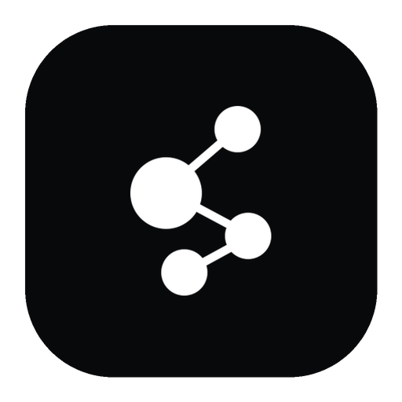
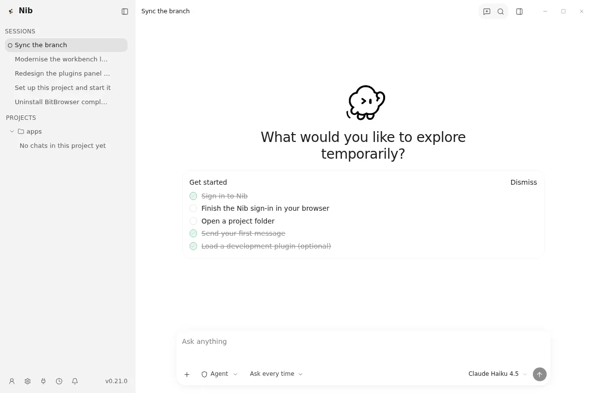

<div align="center">



# Nib

### I am Nib.

**A desktop AI coding agent. One install, one sign-in, every model.**

Windows · macOS · Linux

<br />

[](https://github.com/secretkeyllc/nib/releases/latest)
[](https://github.com/secretkeyllc/nib/releases)
[](LICENSE)

<br />

**[Download](https://nib.am/download.html)** ·
[Documentation](https://nib.am/docs/) ·
[Pricing](https://nib.am/pricing.html) ·
[Changelog](https://nib.am/changelog.html) ·
[简体中文](README.zh-CN.md)

<br />



</div>

---

Nib is an AI coding agent that runs on your machine. It reads your repository, edits files, runs your tests, and keeps working until the task is done or it needs a decision from you.

One subscription covers the app and every model family. There is no per-model pricing, no "bring your own key" setup step, and no second bill when you switch from a fast model to a frontier one.

## What you get

| | |
|---|---|
| **The desktop app** | Sessions, projects, file previews, diffs, and a plan/credits status bar in one window. |
| **Every model** | GPT, Claude, Gemini, Grok and the rest of the catalogue on every paid plan. The plan decides how much you can use, not which models you may call. |
| **One sign-in** | Approve a code in the browser once; the app stores the credential in the OS keychain. |
| **One key** | The `Default` key created with your account also works in Cline, Continue, Zed, and any OpenAI-compatible SDK. |
| **Top-up balance** | Plan credits reset each month. When you burn through them early, add credits that do not expire and are spent only after the plan allowance is gone. |

## Install

Download the installer for your platform from [nib.am/download](https://nib.am/download.html). Every release publishes its SHA256 so you can verify the artifact before running it.

| Platform | Package | Status |
|---|---|---|
| Windows x64 | `Nib-Setup-<version>.exe` | Available |
| macOS | `.dmg` (Apple silicon) | In progress |
| Linux x64 | `.AppImage` / `.deb` | Available |

## Sign in

1. Open Nib and choose **Sign in with Nib**.
2. The browser opens `nib.am/device` with the code already applied.
3. Approve it. The app receives a key, stores it in the OS keychain, and starts working.

The approval page never displays the code: it is carried in the URL and applied automatically, so there is nothing to copy, and a shoulder-surfer cannot read it.

## Point another tool at Nib

The same subscription works outside the app. Create a key in the [console](https://nib.am/app/), then use it as an ordinary API key:

```bash
export NIB_API_KEY=sk-nib-...
export OPENAI_BASE_URL=https://api.nib.am/v1
```

Anthropic-compatible clients use `https://api.nib.am` as the base URL. The full protocol is documented at [nib.am/docs/api](https://nib.am/docs/api.html).

## Build from source

```bash
pnpm install
pnpm --filter "./packages/**" build
pnpm --filter @pi-desktop/desktop build
pnpm --filter @pi-desktop/desktop exec electron-builder --win nsis --x64
```

Linux and macOS builds use the same pipeline with a different `electron-builder` target. The Rust host (`crates/nib-host-core`) must be built for the target platform first; `pnpm build` does it as part of the Electron step.

## Layout

```
apps/desktop/          the Electron app (renderer, main process, preload)
apps/nib-host/         headless agent host used by remote sessions
crates/nib-host-core/  Rust host core: PTY, file watching, protocol
packages/              shared modules: i18n, plugin SDK, agent runtime, RACP
docs/                  architecture notes, ADRs, and the plugin development guide
```

## Licence

LGPL-3.0. See [LICENSE](LICENSE).

This repository is derived from [PI-Desktop](https://github.com/vastsa/PI-Desktop) (LGPL-3.0) and keeps that licence. The Nib product layer — the account provider, the plan/credit surfaces, and the brand — lives in `apps/desktop/resources/plugins/nib.provider/` and the files listed in [NIB.md](NIB.md).
