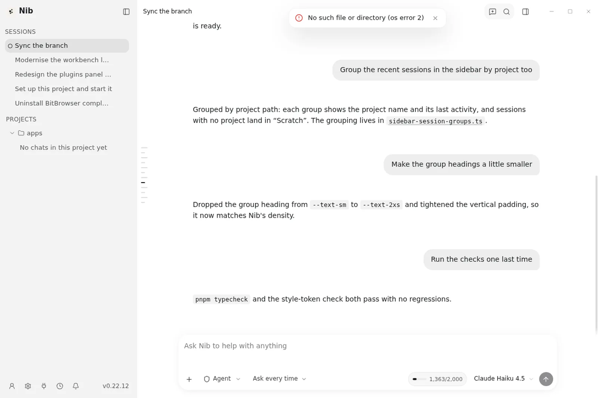
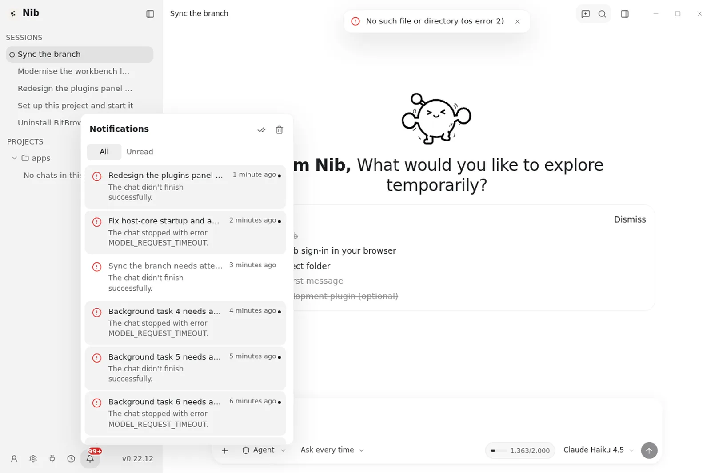

<div align="center">


# Nib

### I am Nib.

**桌面 AI 编程助手。一次安装，一次登录，全部模型。**

Windows · macOS · Linux

<br />

[](https://github.com/secretkeyllc/nib/releases/latest)
[](https://github.com/secretkeyllc/nib/releases)
[](LICENSE)

<br />

**[立即下载](https://nib.am/download.html)** ·
[使用文档](https://nib.am/docs/) ·
[价格](https://nib.am/pricing.html) ·
[更新日志](https://nib.am/changelog.html) ·
[English](README.md)

<br />


<br />




</div>

---

Nib 是运行在你本机的 AI 编程助手。它会读你的仓库、改文件、跑测试，直到任务完成或者需要你做一个决定。

一份订阅同时覆盖客户端与全部模型家族。没有按模型定价，没有"先配一个自己的 key"这一步，也不会因为从快模型切到旗舰模型而多一张账单。

## 你会得到

| | |
|---|---|
| **桌面客户端** | 会话、项目、文件预览、diff，以及一条套餐/额度状态栏，都在同一个窗口里。 |
| **全部模型** | GPT、Claude、Gemini、Grok 以及目录里的其余模型，在任何付费套餐上都能用。套餐决定你能用多少，而不是能用哪些。 |
| **一次登录** | 在浏览器里批准一次验证码，客户端把凭据存进系统钥匙串。 |
| **一把密钥** | 注册时自动创建的 `Default` 密钥，同样可以用在 Cline、Continue、Zed 和任何 OpenAI 兼容 SDK 里。 |
| **充值余额** | 套餐额度每月重置。月中用完时，可以购买不过期的余额——它只在套餐额度耗尽后才被使用。 |

## 安装

从 [nib.am/download](https://nib.am/download.html) 下载对应平台的安装包。每个版本都会公布 SHA256，安装前可以先校验。

| 平台 | 包 | 状态 |
|---|---|---|
| Windows x64 | `Nib-Setup-<version>.exe` | 已发布（0.22.x） |
| macOS | `.dmg`（Apple silicon） | 进行中 |
| Linux x64 | `.AppImage` / `.deb` | 已发布（0.22.x） |

## 登录

1. 打开 Nib，选择 **Sign in with Nib**。
2. 浏览器会打开 `nib.am/device`，验证码已经自动填好。
3. 批准即可。客户端收到密钥、写入系统钥匙串，然后开始工作。

批准页不会显示验证码：它由 URL 携带并自动应用，所以既不用复制，也不怕旁人看到。

## 把别的工具接到 Nib

同一份订阅在客户端之外也能用。在[用户后台](https://nib.am/app/)创建密钥，然后当作普通 API key 使用：

```bash
export NIB_API_KEY=sk-nib-...
export OPENAI_BASE_URL=https://api.nib.am/v1
```

Anthropic 兼容客户端把 base URL 设为 `https://api.nib.am`。完整协议见 [nib.am/docs/api](https://nib.am/docs/api.html)。

## 从源码构建

```bash
pnpm install
pnpm --filter "./packages/**" build
pnpm --filter nib-desktop build
pnpm --filter nib-desktop exec electron-builder --win nsis --x64
```

Linux 和 macOS 走同一条流水线，只是 `electron-builder` 的目标不同。Rust host（`crates/nib-host-core`）需要先按目标平台构建，`pnpm build` 会在 Electron 那一步带上它。

## 目录结构

```
apps/desktop/          Electron 客户端（渲染进程、主进程、preload）
apps/nib-host/         远程会话使用的无头 agent host
crates/nib-host-core/  Rust host core：PTY、文件监听、协议
packages/              共享模块：i18n、插件 SDK、agent runtime、RACP
docs/                  架构说明、ADR、插件开发指南
```

## 许可证

LGPL-3.0，见 [LICENSE](LICENSE)。

本仓库基于 [PI-Desktop](https://github.com/vastsa/PI-Desktop)（LGPL-3.0）并沿用同一许可证。Nib 的产品层——账号 provider、套餐/额度界面、品牌——集中在 `apps/desktop/resources/plugins/nib.provider/` 和 [NIB.md](NIB.md) 列出的文件里。
